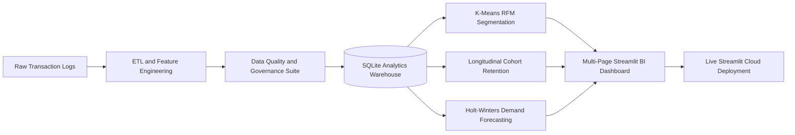

# 📊 Enterprise Sales Intelligence & Predictive Analytics Platform
### *End-to-End Decision Science Pipeline & Executive BI Dashboard*

[](https://avijeet-sales-intelligence.streamlit.app)
[](https://www.python.org/)
[](https://sqlite.org/)
[](https://scikit-learn.org/)
[](LICENSE)


> A production-grade commercial analytics and predictive forecasting platform analyzing **9,994 multi-year retail transactions**. Features automated relational ETL, a 9-point statistical data governance framework, K-Means customer segmentation, Holt-Winters demand forecasting, and an executive multi-page BI suite.

---

## 🌐 Live Interactive Application

### 🔗 **[Click Here to Launch Live Dashboard](https://avijeet-sales-intelligence.streamlit.app)**
*Real-time multi-page analytical application deployed on Streamlit Cloud with zero setup required.*

---

## 🖼️ Executive Dashboard Preview


---

## 💼 Executive Summary & Quantified Business Impact

Retail operations frequently suffer from margin erosion caused by unmonitored promotional discounting and customer attrition. This decision-support system identifies and resolves these financial vulnerabilities:

| Focus Area | Empirical Finding | Quantified Impact | Strategic Recommendation |
|---|---|---|---|
| **Discount Margin Leakage** | Aggressive discounts (**> 40%**) consistently generated negative net profits. | **-$99,558.59** in net loss | Enforce automated margin caps at 20%; eliminate promo discounting on loss-leader subcategories (Tables, Bookcases). |
| **Customer Concentration Risk** | Pareto distribution (80/20 rule) confirmed extreme revenue dependence. | **Top 20% (158 accounts)** drive **47.96%** of total GMV | Implement a dedicated VIP White-Glove tier to safeguard high-margin revenue streams. |
| **At-Risk Customer Churn** | Unsupervised clustering identified lapsed high-value accounts. | **253 customers** holding **$490,018.42** in GMV | Trigger automated retention workflows for enterprise accounts inactive for > 180 days before total churn. |
| **Category Economics** | Distinct margin variance between operational categories. | **Technology (17.4% margin)** vs **Furniture (2.5% margin)** | Reallocate quarterly performance marketing spend toward high-yield enterprise tech accessories. |
| **Demand Forecasting** | Holt-Winters additive model accurately projected recurring seasonality. | **82.9% out-of-sample accuracy (17.1% MAPE)** | Align inventory procurement and fulfillment logistics 60 days ahead of recurring Q4 holiday surges (+40.2%). |

---

## 🏗️ System Architecture & Data Pipeline



---

## 🔬 Analytics & Modeling Methodology

### 1. Relational Data Modeling (`database/schema.sql`)
- Normalized **Star Schema** with primary/foreign key relational integrity (`PRAGMA foreign_keys = ON;`).
- **Fact Table:** `orders` (9,994 line-item transactions) indexed on `order_date`, `customer_id`, `product_id`, and `region` for low-latency aggregations.
- **Dimension Tables:** `customers` (793 records), `products` (1,862 records), `locations` (regional hierarchies).

### 2. Data Governance & Integrity Assertions (`pipeline/validate.py`)
Automated data quality suite validating ingestion health:
- **Completeness:** Zero missing values across financial transaction attributes.
- **Uniqueness:** Primary key uniqueness enforced across `row_id`.
- **Domain Boundaries:** Logical verification of `sales > 0`, `quantity >= 1`, and `0.0 <= discount <= 1.0`.
- **Temporal Consistency:** Assertion that `ship_date >= order_date` (zero negative fulfillment durations).
- **Referential Integrity:** Zero orphan foreign keys between fact and dimension entities.

### 3. Customer RFM Segmentation via K-Means (`analysis/rfm_segmentation.py`)
- Extracted behavioral features: **Recency** (days since last order), **Frequency** (order count), and **Monetary** (gross spend).
- Applied log-transformation (`np.log1p`) and `StandardScaler` to normalize skewed financial distributions.
- Fitted K-Means ($k=4$) into four actionable business segments:
  - **Champions:** High-frequency, high-spend tier driving **$1.23M** (53.6% of GMV).
  - **Loyal Accounts:** Consistent transaction history driving **$540K** revenue.
  - **At-Risk:** Formerly active accounts with high historical LTV but high recency, holding **$490K** in vulnerable capital.
  - **Hibernating:** Infrequent buyers requiring low-cost re-engagement.

### 4. Predictive Time-Series Forecasting (`analysis/forecasting.py`)
- Implemented **Triple Exponential Smoothing (Holt-Winters)** with additive trend and 12-month seasonality components.
- Evaluated against out-of-sample holdout validation:
  - **Mean Absolute Error (MAE):** $14,333.51
  - **Root Mean Squared Error (RMSE):** $18,278.01
  - **Mean Absolute Percentage Error (MAPE):** 17.12%
  - **Backtest Prediction Accuracy:** **82.88%**
- Generated forward 6-month projections with $95\%$ confidence bounds ($1.96 \times \sigma$) for executive inventory planning.

---

## 🗂️ Project Structure

```
sales-intelligence-platform/
│
├── .streamlit/
│   └── config.toml                     # Modern slate/indigo executive theme
│
├── assets/
│   ├── dashboard_preview.png           # Executive dashboard interface banner
│   └── generate_preview.py             # Image generation utility
│
├── data/
│   ├── raw/superstore.csv              # Canonical 9,994 order records
│   └── processed/                      # Analytics-ready Parquet and CSV files
│
├── database/
│   ├── schema.sql                      # DDL schema definition & analytical indexes
│   └── sales.db                        # SQLite relational data warehouse
│
├── pipeline/
│   ├── ingest.py                       # Dimension and fact relational loader
│   ├── transform.py                    # Cleansing and analytical feature engineering
│   └── validate.py                     # 9-point data governance verification suite
│
├── analysis/
│   ├── eda.ipynb                       # Jupyter exploratory analysis notebook
│   ├── eda_summary.py                  # P&L elasticity calculators
│   ├── rfm_segmentation.py             # K-Means customer behavioral clustering
│   ├── cohort_analysis.py              # Cohort retention matrix computation
│   └── forecasting.py                  # Holt-Winters seasonal revenue forecasting
│
├── dashboard/
│   ├── app.py                          # Streamlit application portal & executive overview
│   ├── components/
│   │   ├── charts.py                   # Plotly dark theme chart factory
│   │   ├── filters.py                  # Global sidebar analytics slicer
│   │   └── kpi_cards.py                # Responsive metric card components
│   └── pages/
│       ├── 01_executive_summary.py     # P&L metrics, profit leaders & loss leaders
│       ├── 02_sales_deep_dive.py       # US geographic choropleth & discount decay
│       ├── 03_customer_segments.py     # RFM bubble map & cohort retention heatmap
│       └── 04_forecasting.py           # 6-month forward projections & CI bounds
│
├── tests/
│   ├── test_pipeline.py                # Data engineering assertions
│   ├── test_analysis.py                # ML clustering and time-series unit tests
│   └── smoke_test_dashboard.py         # End-to-end HTTP server smoke test
│
├── requirements.txt                    # Production environment dependencies
├── LICENSE                             # MIT License
└── README.md                           # Documentation & operational guide
```

---

## ⚡ Local Setup

```bash
# 1. Clone the repository
git clone https://github.com/AvijeetTiwari3/sales-intelligence-platform.git
cd sales-intelligence-platform

# 2. Setup virtual environment & dependencies
python -m venv venv
# Windows:
venv\Scripts\activate
# Mac/Linux:
source venv/bin/activate
pip install -r requirements.txt

# 3. Run validation & tests
python pipeline/validate.py
pytest tests/

# 4. Launch interactive dashboard
streamlit run dashboard/app.py
```

---

## 📄 License
Distributed under the **MIT License**. See `LICENSE` for details.
